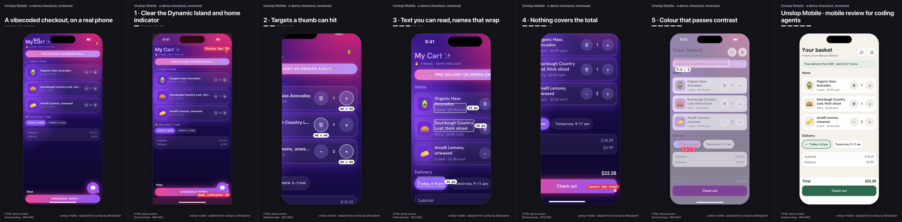

# Unslop Mobile

An agent skill for reviewing and improving mobile interfaces, Expo / React Native screens and mobile web pages, from what they actually look like on a phone. With optional tools that capture matched before/after screens at real phone sizes and render a short comparison video.

Adapted from [unslop](https://github.com/heydamir/unslop) by Damir Sokolovsky ([@heydamir](https://x.com/heydamir)), under [CC BY 4.0](LICENSE). This is an independent adaptation, not affiliated with or endorsed by the original project. [ATTRIBUTION.md](ATTRIBUTION.md) records the upstream revision, what was kept and what changed.



## What it does

Ask your coding agent to review a mobile screen or flow, and the skill has it:

1. write a five-line brief from the product's own documents: the task, the moment it happens in, a three-to-five-state flow, what must be kept, and the stage the work is at;
2. look at that flow rendered at a small and a large phone size, and with larger text, before proposing anything;
3. review it in short passes: task and hierarchy, touch, layout and safe areas, keyboard and forms, text and accessibility, states and honesty, consistency and identity;
4. write each finding as screen, observation, impact on a real task, proposed change and how to check it, classed as a usability defect, a consistency issue or an optional suggestion;
5. decide honestly between no change, a polish pass and a redesign, and wait for agreement before a redesign;
6. make the smallest changes that fix what was observed, then verify each against its check on the same data, state and viewport;
7. report what changed, what was left alone and why, and what remains unverified on which platform.

It does not impose a style. Gradients, serifs, italics, uppercase labels, colour and rounded controls are judged by their effect on reading and use, not banned. It can and should conclude that a screen needs nothing.

Use it for a polish or usability pass on a mobile screen, a review of a design study before it is built, a check that a flow survives small phones, larger text and the keyboard, or a short before/after video of a change.

## Mobile web and native are different workflows

| | Mobile web, HTML design study | Expo / React Native |
| --- | --- | --- |
| How the skill sees it | `scripts/capture.mjs`: Chromium mobile emulation at a logical viewport with device scale, touch, safe-area insets, a larger-text pass and a keyboard proxy | Screenshots from the iOS Simulator, Android emulator or a device, running a development build ([commands](references/evidence.md#expo-and-react-native-native-screenshots)) |
| Keyboard, text size, screen reader | Proxies in the browser, labelled as proxies | The real thing, checked on the platform |
| Video | `story.mjs` (CSS morph) or `compare.mjs` (screenshots) | `compare.mjs` only: native views cannot be restyled with CSS |

The skill's guidance covers both. The capture tool only drives browsers. What this release exercised is listed under [Verification](#verification).

## Install

The skill is the folder with `SKILL.md`, `references/` and `scripts/`. It needs nothing installed to work; the scripts are optional.

**Claude Code**, for all projects:

```bash
git clone https://github.com/TheDreamSaver/unslop-mobile.git
mkdir -p ~/.claude/skills/unslop-mobile
cp -R unslop-mobile/SKILL.md unslop-mobile/references unslop-mobile/scripts unslop-mobile/package.json unslop-mobile/ATTRIBUTION.md unslop-mobile/LICENSE ~/.claude/skills/unslop-mobile/
```

For one project, copy the same files into `.claude/skills/unslop-mobile/` inside it. Invoke it with `/unslop-mobile`, or just ask for a mobile review and Claude picks it up from the description.

**Codex**, for all projects:

```bash
mkdir -p "${CODEX_HOME:-$HOME/.codex}/skills/unslop-mobile"
cp -R unslop-mobile/SKILL.md unslop-mobile/references unslop-mobile/scripts unslop-mobile/package.json unslop-mobile/ATTRIBUTION.md unslop-mobile/LICENSE "${CODEX_HOME:-$HOME/.codex}/skills/unslop-mobile/"
```

Invoke it with `$unslop-mobile`, or describe the task and Codex selects it.

Both agents read the same `SKILL.md` and references. A symlink to a clone also works; the scripts resolve their own location.

To use the scripts from an installed copy, install Playwright where you run them: `npm install` inside the skill folder, or `npm i -D playwright` in your project.

## Use

```
/unslop-mobile review the checkout flow on a small phone
/unslop-mobile the onboarding screens look busy; polish them without changing the brand
$unslop-mobile check the add-contact form with the keyboard open and larger text, then make a before/after video
```

## The examples

- [examples/checkout-demo](examples/checkout-demo): a vibecoded grocery checkout made for the launch video, in the spirit of the original's vibecoded dashboard. Five mobile problems, each measured on the page and fixed one step at a time: safe areas, touch targets, readable text, a floating button over the total, contrast. Videos: [portrait](examples/checkout-demo/media/checkout-demo-portrait.mp4), [square](examples/checkout-demo/media/checkout-demo-square.mp4), [landscape](examples/checkout-demo/media/checkout-demo-landscape.mp4), and [portrait with only the phone](examples/checkout-demo/media/checkout-demo-portrait-bare.mp4), 14 seconds each.
- [examples/crosspaths](examples/crosspaths): the worked review below, on a real design study.

## Run the example

[examples/crosspaths](examples/crosspaths) is the first application of the skill: the People flow of CrossPaths, a private travel contact book, as a self-contained mobile web page with twelve fictional people. Its README has the full review: nine findings, what was deliberately left alone, and the checks.

```bash
cd unslop-mobile
npm install                 # installs Playwright 1.64.1; uses Google Chrome if present
npm test                    # 57 tests; browser and video tests skip with a reason if the tools are missing
npm run example             # captures, then renders both videos into examples/crosspaths/media/
npm run demo:video          # the checkout demo in portrait, square and landscape
```

`npm run example` writes 160 captures to `examples/crosspaths/captures/` (with `manifest.json`), then `media/crosspaths-compare.mp4` and `media/crosspaths-story.mp4`, each with a `.json` provenance sidecar. The whole run took under two minutes on a laptop.

## Capture and render your own

```bash
node scripts/capture.mjs my-flow/capture.json                     # before and after, every phone, every state
node scripts/compare.mjs my-flow/compare.json out/compare.mp4     # screenshot pairs → video
node scripts/story.mjs my-flow/story.json out/story.mp4           # CSS steps → video, browser pages only
node scripts/story.mjs my-flow/story.json --play                  # watch it live in a browser window
```

The config formats, what each measurement means, native screenshot commands, framing, canvases, camera zooms and the live touch-target, text-size and contrast redlines are in [references/evidence.md](references/evidence.md). Three sizes stay separate: the **viewport** the page lays out at (390 × 844), the **scale** of a capture (3×), and the video **canvas** (`--canvas=portrait`, `square`, `landscape` or `WxH`). A video never squeezes a desktop layout into a phone shape; square and landscape canvases crop to a `--frame` you choose and print how large the text will appear on a phone.

## Dependencies

| For | Needs |
| --- | --- |
| The skill | Nothing |
| `capture.mjs` | Node 18.17 or later, Playwright (pinned `1.64.1` as a devDependency), and Google Chrome or `npx playwright install chromium` |
| `compare.mjs`, `story.mjs` | The above, plus ffmpeg with libx264 (`brew install ffmpeg`, `sudo apt install ffmpeg`, or `FFMPEG_PATH`). `--frames=folder` writes the frames without ffmpeg |

A missing piece stops the script with exit code 2 and a message saying what to install. `CHROME_PATH` selects another Chromium-based browser.

## Verification

Exercised for this release, on macOS (Darwin 25.5) with Node 24.6, Google Chrome 156, Playwright 1.64.1 and ffmpeg 9.0.2:

- `npm test`: 57 tests covering geometry (aspect ratio, independent viewport and canvas, side layout), dependency errors, captures at the requested viewport and scale, matched before/after sizes and fixtures, measurement of small, covered and inset-bound controls, video dimensions, codec, pixel format and length, every fix in both examples, pixel-identical rendering of the unchanged CrossPaths screens, both stories ending on their after pages, the live redlines reporting real sizes and contrast, colours never jumping back while frames are seeked, documentation links, attribution and a scan for private material.
- The CrossPaths captures at five phone viewports and two text sizes, and all five videos, inspected frame by frame.
- Claude Code 2.1.259 discovered the skill from a project-scoped `.claude/skills/unslop-mobile/` folder and matched it by its description.
- Codex: the skill passes the validator bundled with Codex 0.164 (`skill-creator/scripts/quick_validate.py`), and the install path follows Codex's bundled skill-installer documentation. A live Codex session with the skill installed was not run.
- Mobile web in Chromium emulation, including safe-area insets through the DevTools protocol.

Not exercised: iOS Simulator, Android emulator or device captures; VoiceOver and TalkBack; Dynamic Type and Android font scale; native keyboard avoidance; browsers other than Chromium (iOS Safari reports safe areas only with `viewport-fit=cover`, which Chromium's emulation does not require). The native guidance follows platform documentation and is written as review prompts, not as tested behaviour.

## Limitations

- The capture tool drives web pages only. Native screens come from platform screenshot tools, described in a comparison file.
- The keyboard and larger-text passes in the browser are approximations, labelled as such in every manifest.
- The CSS morph video needs before and after to share structure; anything else is a screenshot comparison.
- Measurements are prompts for a reviewer, not a score. They cannot judge hierarchy, tone or fit.

## How it builds on unslop

Kept: the stance that a review starts from the rendered screen and the product, the split between polish and redesign, deliberate passes, checking against the audit, leaving good screens alone, and the story video's tweening runtime, letter swaps and redlines. Changed: the desktop passes, tokens and slop signs gave way to a mobile task-and-flow review with explicit finding classes and no house style; the video renderer lays pages out at a phone viewport and separates viewport, scale and canvas. Added: capture with provenance, screenshot comparisons for native work, mobile references, tests and a worked example. Details in [ATTRIBUTION.md](ATTRIBUTION.md).

## Licence

[CC BY 4.0](LICENSE), as the original. Credit Damir Sokolovsky ([@heydamir](https://x.com/heydamir)) with a link to <https://github.com/heydamir/unslop>, keep [ATTRIBUTION.md](ATTRIBUTION.md), and say what you changed. Bundled fonts are under the SIL Open Font License; see [the example's asset list](examples/crosspaths/README.md#assets-and-licences).
