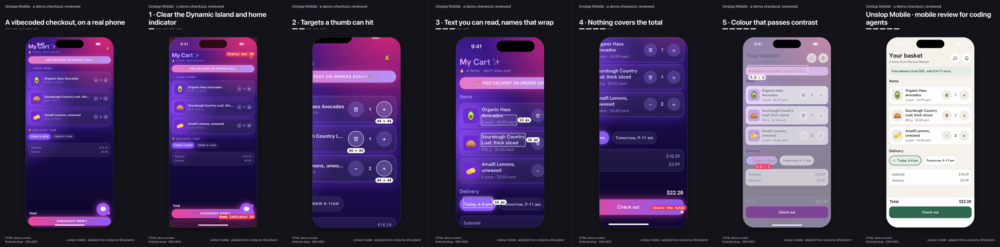

# Demo: a vibecoded checkout, reviewed

A screen made for the launch video, in the spirit of the original unslop's vibecoded dashboard: a grocery checkout for **Marlow Market**, a fictional shop, as a first draft generated without looking at a phone, and the same screen after a mobile review. It is a demo, not a product. The CrossPaths example ([../crosspaths](../crosspaths)) is the worked review of a real design study.



## What is wrong with the draft, and what changes

Every problem is something that goes wrong on an actual phone, and each one is measured in [tests/demo.test.mjs](../../tests/demo.test.mjs) on both versions of the page.

| Step | Draft (`app.html?variant=before`) | Reviewed (`app.html`) | Fix |
| --- | --- | --- | --- |
| 1 · Safe areas | A top padding hard-coded to 20 pt, the status bar of phones without a notch, so on a 59 pt Dynamic Island phone the title sits under the clock and the island; the checkout button sits on the home indicator | Header below the 59 pt top inset, checkout above the 34 pt bottom inset | [1-safe-areas.css](assets/fixes/1-safe-areas.css) |
| 2 · Touch targets | 24 × 24 quantity buttons 2 px apart; removing an item needs a hover-only × | 44 × 44 buttons with room between them; at quantity 1 the minus becomes a remove button | [2-touch.css](assets/fixes/2-touch.css) |
| 3 · Readable text | 10 px uppercase meta, 10 px slot labels, a product name cut off at "thic…", two money formats | 13–16 px sentence case, names wrap, one money format, one typeface | [3-text.css](assets/fixes/3-text.css) |
| 4 · Nothing covers the total | A pulsing chat bubble sits on the order total | Chat moves into the header; the list leaves room for the checkout bar | [4-covered.css](assets/fixes/4-covered.css) |
| 5 · Contrast | White on a pink-to-violet gradient at 2.7:1; the chosen delivery slot is marked by colour alone | Market palette, every text pair above 4.5:1; the chosen slot has a check and an outline | [5-color.css](assets/fixes/5-color.css) |

The gradients, glows and emoji are typical of generated screens, and here each one causes a problem you can measure: contrast, an icon that is too small to tap, labels that say less than words would. Gradients and emoji are not wrong by themselves; see [SKILL.md](../../SKILL.md#judgment).

## Render it

```bash
npm run demo:video        # portrait, square and landscape cuts into media/
node scripts/story.mjs examples/checkout-demo/story.json --play     # watch it live
```

Open [app.html](app.html) in a browser at a phone size to try both versions; quantities and the delivery slot work, nothing is ordered.

The story ([story.json](story.json)) uses the renderer's mobile features: a 393 × 852 viewport with the iPhone's safe areas, the device's status bar and Dynamic Island drawn inside the top inset (`deviceChrome`), camera zooms onto the part each step changes, live touch-target, text-size and contrast measurements, faster motion than the default, and a side-caption layout for the square and landscape cuts. [story/prepare.js](story/prepare.js) marks which words roll over at which step; both versions of every string come from the page's own copy table.

## Which cut to post

Platform behaviour as of October 2026; check again before relying on it.

- **Portrait (1080 × 1920)** shows the phone at 1.74× its logical size, so 14 px interface text plays at about 8.8 pt on a phone, and it fills a phone held upright. It is the cut that represents the mobile experience best. X stopped cropping vertical video in the timeline in February 2026 and opens it full screen with a tap; LinkedIn shows 9:16 at full height on phones and with side bars on desktop.
- **Square (1080 × 1080)** suits a LinkedIn audience that reads on desktop: it displays whole everywhere, and the side layout keeps the captions large, but the phone is at 1.04× (about 5.3 pt text) between the zoomed steps.
- **Landscape (1920 × 1080)** is for slides, a website or a talk, not a phone feed.

## Files

| File | What it is |
| --- | --- |
| [app.html](app.html) | The page. `?variant=before` disables the fix stylesheets |
| [assets/app.css](assets/app.css) | The vibecoded draft |
| [assets/fixes/](assets/fixes/) | One stylesheet per fix, linked by the reviewed page and applied by the story one step at a time |
| [assets/app.js](assets/app.js) | Items, totals, quantity and slot behaviour, and the copy of both versions |
| [story.json](story.json), [story/prepare.js](story/prepare.js) | The video |
| [media/](media/) | Portrait, square and landscape renders with provenance sidecars, and a frame strip |

## Assets and licences

| Material | Source | Licence |
| --- | --- | --- |
| `assets/fonts/HankenGrotesk-Variable.ttf` | Hanken Grotesk 3.013 from the [Google Fonts repository](https://github.com/google/fonts/tree/main/ofl/hankengrotesk), unmodified | SIL OFL 1.1, [HankenGrotesk-OFL.txt](assets/fonts/HankenGrotesk-OFL.txt) |
| Produce illustrations and line icons in `app.html` | Drawn for this demo as simple SVG | Part of this package |
| Emoji in the draft | The operating system's emoji font, not bundled; they look different on each platform | System font |
| Marlow Market, its products and prices | Invented | Part of this package |
