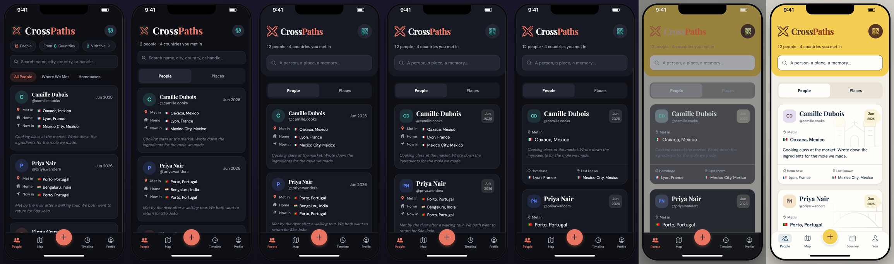

# CrossPaths People, redesigned in place

[](media/crosspaths-people-transformation-bare.mp4)

**[Watch the video](media/crosspaths-people-transformation-bare.mp4)**: portrait 1080 × 1920, 17 seconds, 30 fps, silent, only the phone.

One screen throughout: the CrossPaths People screen, starting as the original dark Expo screen and turning into the Cocoa & Rust Passage redesign. The elements themselves change: they leave, move, resize, appear and change colour. There is no navigation, split screen, screenshot wipe or crossfade.

**What this is.** An authored HTML animation that illustrates the app's redesign. It is not a recording of the app or of a device, and the app does not animate like this. CrossPaths is Expo / React Native, and native views cannot be tweened with CSS. So [app.html](app.html) is a video-only reconstruction of the People screen, built from the app's source and from measured element boxes, and the steps tween it. Its first and last states match browser captures of the Expo app's web export (see [Checks](#checks)). Keep this explanation with the video wherever it is posted, because the frame carries no text.

## The beats

1. **Count and switch.** The statistic and visa pills give way to "12 people · 4 countries you met in". The three grouping tabs become a People / Places switch.
2. **Header.** The header becomes its own panel. The black logo tile goes and the crossed paths stay, as the transparent mark. The wordmark tightens, the globe button becomes the travel QR code, and search grows and asks for "A person, a place, a memory…".
3. **Card heads.** Names grow, avatars become rounded squares with initials, and the meeting month becomes a stamp.
4. **Card body.** Home and Now in step aside. Where you met gets its own label and a larger line. The memory moves up to be read next, and the other two places return as a footer, Homebase and Last known. All three location meanings stay; nothing claims a live location.
5. **Palette.** Cocoa & Rust Passage sweeps down the screen: page `#F3EFE6`, cards `#FFFEFA`, header `#F4CE52`, Cocoa `#563525` on the mark, Cross and QR button, Rust `#963E1B` on Paths, text `#24364B`.
6. **Landmarks.** The faint Oaxaca and Porto scenes come into Camille's and Priya's cards.
7. **Tab bar.** A rounded sheet, an action-blue `#284D6B` pill on the selected tab, outline icons and a gold + in the centre. Timeline becomes Journey and Profile becomes You.

Camille Dubois and Priya Nair stay first and second throughout, as in the captures.

## How it is built

- [app.html](app.html), [assets/app.css](assets/app.css) and [assets/app.js](assets/app.js) are the original screen, rendered from the fixture as the app did: the same order, counts, flags and wording. Every size, position and colour comes from the original source or from the export's measured boxes.
- [assets/steps/](assets/steps/) has one stylesheet per beat, ending on the redesign's values from its source (`theme.ts`, `ContactCard.tsx`, `_layout.tsx`, `Brand.tsx`). [story/prepare.js](story/prepare.js) marks the reworded strings and the controls that leave.
- Card contents are positioned, not flowed, because the redesign reorders them. Home and Now in fade before anything crosses them, and come back in the footer. The year and the meeting place drop before they slide, so no text runs over other text.
- **Typeface.** The redesign changes DM Sans to Hanken Grotesk and the italic memory to upright text. A typeface cannot tween, so each line switches face at the moment its colour meets the colour behind it in the palette sweep, where the switch cannot be seen. A test checks that every switch happens below 1.3 : 1 contrast. Words that are reworded roll in already in the new face.
- Only the three people who are ever on screen are drawn; the fourth card would start below the tab bar.
- The status bar, notch and home indicator are drawn by the renderer (`deviceChrome`), with a 47 / 34 pt safe area for a 390 × 844 iPhone. The app's header and tab bar pad for them as React Native's safe-area insets do.

## Render

From the Unslop Mobile folder:

```bash
node scripts/story.mjs examples/crosspaths-people-transformation/story.json examples/crosspaths-people-transformation/media/crosspaths-people-transformation-bare.mp4
```

The story is bare by default (`"bare": true`). The render takes about 20 seconds and writes a `.json` sidecar with source and stylesheet hashes. Add `--play` to watch it live in a browser.

## Checks

These were run on this machine with Chrome 156, Playwright 1.64.1 and ffmpeg 9.0.2.

- **Start and end.** The reconstruction's first and last states were rendered at 390 × 844, 2×, with no insets, and compared with [reference/before-people.png](reference/before-people.png) and [reference/after-people.png](reference/after-people.png). Each differs in 0.03% of pixels; the differences are glyph kerning where the reconstruction splits a text run. As the video shows it, with the rolled-in words still in letter spans, the end differs in 0.23%. Those captures were first confirmed pixel-identical to fresh captures of the before and after Expo exports with the same fixture. The video's own first and last screens, rendered once without insets, match the references to within resampling.
- **Motion.** Frames were inspected at every step. A frame-by-frame scan found no isolated jumps. The only single-frame change is a 1 px shift of the Homebases tab when its neighbours' words are pinned for the swap, just before it fades out.
- **File.** H.264 High, yuv420p, 1080 × 1920, square pixels, 30 fps constant, one video stream and no audio.
- `npm test` covers the start and end against the references, names and order of the people, the low-contrast typeface switches, and the licences and fixture here.

## Sources and provenance

All inputs come from the CrossPaths repository, read without changes.

| Here | From CrossPaths | sha256 |
| --- | --- | --- |
| [reference/before-people.png](reference/before-people.png) | `memory/implementation/captures/before-people.png`, browser capture of the original Expo export (HEAD `257147d`) | `672459f6…` |
| [reference/after-people.png](reference/after-people.png) | `memory/implementation/captures/after-people.png`, browser capture of the redesigned export | `68d33200…` |
| [assets/people.js](assets/people.js) | `memory/implementation/demo-book.json`, twelve fictional people; phone numbers and empty photos left out | `6beb742c…` |
| [assets/landmarks.js](assets/landmarks.js) | `frontend/src/components/landmarks.json` | `a11ba780…` |
| [assets/images/logo.png](assets/images/logo.png) | `frontend/assets/images/logo.png`, the original black-tile logo | `30778b99…` |
| The mark in [app.html](app.html) | `memory/design-assets/crosspaths-mark.svg` and `Brand.tsx` | |
| [assets/fonts/](assets/fonts/) | `frontend/assets/fonts/`, plus Ionicons from `@expo/vector-icons` 15.1.1 | |

The original layout follows `app/(tabs)/index.tsx`, `ContactCard.tsx`, `_layout.tsx` and `theme.ts` at `257147d`. The redesigned layout follows the source recorded in CrossPaths' `after-source-manifest.json`, the version the after capture was made from. The app has moved on since: `ContactCard.tsx` has changed. The video shows the captured endpoint, not later edits.

## Credit and licences

The renderer is [Unslop Mobile](https://github.com/TheDreamSaver/unslop-mobile), adapted from [unslop](https://github.com/heydamir/unslop) by Damir Sokolovsky (@heydamir), CC BY 4.0. The video carries no credit in the frame, so wherever it is posted, include: **adapted from unslop by @heydamir**, https://github.com/heydamir/unslop, using https://github.com/TheDreamSaver/unslop-mobile, CC BY 4.0.

Fonts are under the SIL Open Font License: [DM Sans](assets/fonts/DMSans-OFL.txt), [Hanken Grotesk](assets/fonts/HankenGrotesk-OFL.txt) and [Playfair Display](assets/fonts/PlayfairDisplay-OFL.txt). Ionicons is under the MIT License; the [licence file](assets/fonts/Ionicons-LICENSE.txt) is the one react-native-vector-icons distributes the font with. The CrossPaths name, mark, landmark scenes and screen design belong to the CrossPaths project.
